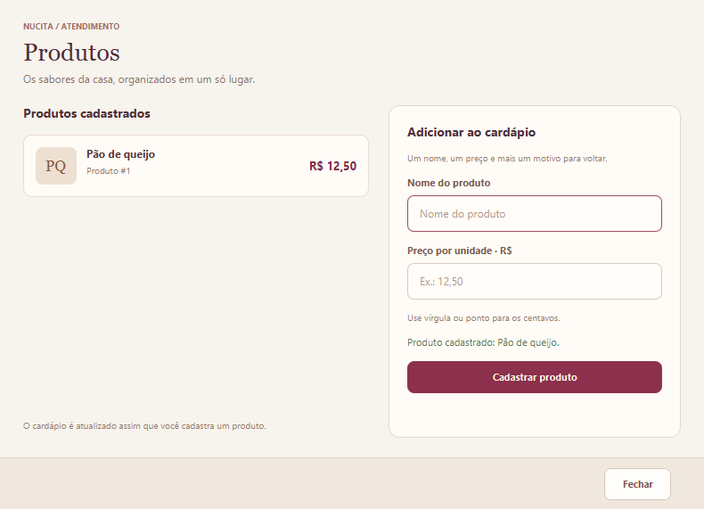
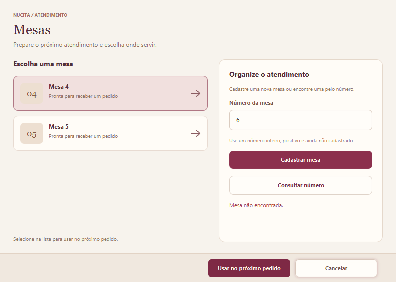
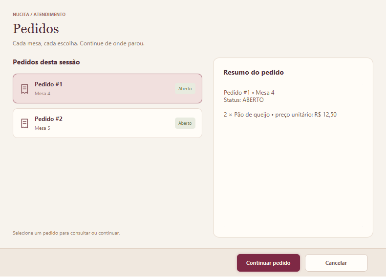

<div align="center">
  
  <h1>Nucita Lanches · JavaFX</h1>
  <p><strong>O cuidado de sempre, em cada pedido.</strong></p>
  <p>Interface desktop para organizar o atendimento, os produtos e os pedidos das mesas da Nucita Lanches.</p>
  <p><a href="#funcionalidades">Funcionalidades</a> · <a href="#como-executar">Como executar</a> · <a href="#como-usar">Como usar</a> · <a href="#testes">Testes</a></p>
</div>

---

## Sobre o projeto

Este repositório reúne a interface JavaFX da **Nucita Lanches**, com a identidade visual da marca: preto, vinho, creme e detalhes em avelã. A versão integrada está na pasta **[`outputs/`](outputs/)** e conecta as telas às operações Java já implementadas no repositório [Nucita-Lanches/Nucita-Lanches](https://github.com/Nucita-Lanches/Nucita-Lanches).

O atendimento permite cadastrar produtos e mesas, abrir pedidos, incluir itens e consultar o que foi registrado durante a sessão.

> **Estado atual:** aplicação funcional com armazenamento em memória. Produtos, mesas e pedidos são apagados ao fechar. Cálculo de total, remoção de itens e finalização de pedidos continuam planejados no código de negócio.

## Prévia da interface


*A captura utiliza dados de exemplo criados durante os testes. A aplicação inicia sem cadastros de demonstração.*

<details>
<summary><strong>Ver as telas de produtos, mesas e pedidos</strong></summary>

### Cadastro de produtos



### Cadastro e seleção de mesas



### Consulta de pedidos



</details>

## Funcionalidades

| Área | Disponível nesta versão |
| --- | --- |
| **Produtos** | Cadastrar nome e preço; listar os produtos e buscar pelo nome, ignorando acentos. |
| **Mesas** | Cadastrar números positivos e únicos; consultar, listar e selecionar uma mesa. |
| **Pedidos** | Abrir um pedido para uma mesa cadastrada e receber um número de identificação. |
| **Itens** | Adicionar produtos com quantidade inteira e positiva; consultar nome, quantidade e preço unitário. |
| **Atendimento** | Selecionar um pedido existente para continuar incluindo itens; manter vários pedidos para a mesma mesa. |
| **Interface** | Grade adaptável, formulários com validação, ícones vetoriais, mensagens de retorno e orientação nas telas vazias. |

**Ainda planejado no domínio:** subtotal e total do pedido, remoção de itens, finalização com bloqueio de alterações e persistência dos dados após fechar o aplicativo. O modelo possui o estado `FINALIZADO`, mas a operação de finalização ainda não está implementada.

## Tecnologias

| Tecnologia | Versão ou finalidade |
| --- | --- |
| **Java** | JDK 21; linguagem e regras da aplicação. |
| **JavaFX** | 21.0.6; componentes e execução da interface desktop. |
| **FXML** | Composição declarativa da tela principal. |
| **CSS** | Tema visual e estados dos componentes. |
| **Maven** | Dependências, compilação e execução. |
| **JUnit 5** | 5.12.1; testes de domínio, aplicação e interface. |

As versões estão definidas em [`outputs/pom.xml`](outputs/pom.xml).

## Como executar

### Requisitos

- **JDK 21**, com `java` e `javac` disponíveis no computador.
- **Maven**, ou IntelliJ IDEA com suporte a projetos Maven.
- Conexão com a internet no primeiro carregamento das dependências.
- Ambiente gráfico para abrir o JavaFX.

### Pelo terminal

Clone o repositório:

```sh
git clone https://github.com/Nucita-Lanches/Teste-JavaFX.git
cd Teste-JavaFX
```

A integração e o novo design estão na branch do [PR #1](https://github.com/Nucita-Lanches/Teste-JavaFX/pull/1). Enquanto essa versão estiver em revisão, selecione-a:

```sh
git switch feat/integracao-design-javafx
```

Entre na pasta do projeto e execute:

```sh
cd outputs
mvn javafx:run
```

### Pelo IntelliJ IDEA

1. Abra o arquivo **[`outputs/pom.xml`](outputs/pom.xml)** como projeto Maven.
2. Configure o **Project SDK para Java 21**.
3. Carregue as dependências do Maven.
4. Na janela Maven, execute **Plugins → javafx → javafx:run**.

### Pelo iniciador do Windows

Depois de carregar as dependências pelo Maven ou IntelliJ, abra **[`outputs/Executar-Nucita.cmd`](outputs/Executar-Nucita.cmd)**.

O iniciador compila os fontes e usa os arquivos JavaFX 21.0.6 para Windows presentes no cache padrão do Maven, em `%USERPROFILE%\.m2\repository`. Se você usa um cache personalizado, prefira a execução pelo Maven ou pela IDE.

## Como usar

1. **Cadastre os produtos.** Abra **Produtos**, informe nome e preço e clique em **Cadastrar produto**. Use valores como `12,50` ou `12.50`, sem separador de milhar.
2. **Prepare as mesas.** Abra **Mesas**, cadastre um número positivo e selecione **Usar no próximo pedido**.
3. **Abra o atendimento.** Clique em **Novo pedido** para criar um pedido vinculado à mesa selecionada.
4. **Inclua os itens.** No cardápio, clique em **Adicionar**, informe a quantidade e confirme.
5. **Continue um pedido.** Abra **Pedidos**, selecione o registro desejado e clique em **Continuar pedido**.

Selecionar outra mesa prepara o próximo pedido e mantém a associação do pedido atual à mesa original. Cada inclusão gera um item no pedido, conforme o comportamento do código de negócio.

## Testes

Na pasta `outputs`, execute:

```sh
mvn test
```

Na validação de **26/10/2026**, os **14 testes passaram**:

- **13 testes de domínio e aplicação**, cobrindo pedidos, itens, associação com mesas e validações.
- **1 teste de integração JavaFX**, que abre o FXML e usa os botões e formulários reais para verificar os cadastros, consultas, quantidades, seleção de pedidos e disposição dos cartões.

O teste JavaFX requer uma sessão gráfica. Também confere o cardápio com seis produtos e a janela de **1220 × 730**.

Os relatórios são gerados em `outputs/target/surefire-reports/` e as capturas em `outputs/target/ui-check/`. Os dados dos testes pertencem ao processo de teste e não são carregados na execução normal.

Para compilar os fontes pelo Maven:

```sh
mvn compile
```

## Estrutura do repositório

```text
Teste-JavaFX/
├── README.md
├── docs/images/                         # Capturas usadas nesta documentação
├── outputs/                             # Versão integrada do atendimento
│   ├── pom.xml
│   ├── Executar-Nucita.cmd
│   ├── Executar-Nucita.ps1
│   ├── TEMA-JAVAFX.md
│   └── src/
│       ├── main/
│       │   ├── java/br/com/nucitalanches/preview/
│       │   │   ├── NucitaPreviewApp.java # Entrada da aplicação
│       │   │   ├── MenuController.java   # Interações das telas
│       │   │   └── UiIcons.java          # Ícones vetoriais
│       │   ├── java/com/senai/nucitalanches/nucitalanches/
│       │   │   ├── application/         # Operações de Restaurante
│       │   │   ├── domain/              # Produto, Mesa, Pedido e itens
│       │   │   └── storage/             # Coleções em memória
│       │   └── resources/               # FXML, CSS e imagens
│       └── test/java/                   # Testes de domínio e interface
└── outputs1/                            # Outra versão da interface
```

A aplicação carrega o FXML e o CSS de `outputs/src/main/resources/`. As cópias desses arquivos na raiz de `outputs/` são referências. `build/` e `target/` são diretórios gerados; as novas alterações no projeto integrado não incluem esses artefatos no controle de versão.

## Organização do código

As telas chamam a classe **`Restaurante`** para cadastrar produtos e mesas, criar pedidos e adicionar itens. Os modelos **`Produto`**, **`Mesa`**, **`Pedido`** e **`ItemPedido`** representam os dados e suas validações. **`BancoDeDados`** mantém as coleções em memória e disponibiliza a consulta dos pedidos.

As classes de negócio foram incorporadas do repositório [Nucita-Lanches/Nucita-Lanches](https://github.com/Nucita-Lanches/Nucita-Lanches), no commit [`f30e1d1`](https://github.com/Nucita-Lanches/Nucita-Lanches/commit/f30e1d1c86a10699b87a8db29fc2b1498f81faf6). A integração acontece por chamadas Java locais. Atualizações no repositório de origem precisam ser incorporadas ao projeto; não há sincronização automática ou API de servidor.

## Problemas comuns

| Situação | Como resolver |
| --- | --- |
| `java` ou `javac` não encontrado | Instale/configure o JDK 21 e verifique o `PATH` ou o SDK da IDE. |
| Dependência JavaFX ausente no iniciador | Carregue `outputs/pom.xml` no Maven ou IntelliJ e aguarde o download das dependências. |
| Maven não encontra o projeto | Execute o comando na pasta `outputs`, onde está o `pom.xml`. |
| O botão de adicionar está desabilitado | Cadastre e selecione uma mesa e abra um **Novo pedido**. |
| O cadastro da mesa foi recusado | Informe um número inteiro positivo que ainda não esteja cadastrado. |
| Os cadastros desapareceram ao reabrir | O armazenamento atual funciona somente durante a sessão. |

## Contribuição

Organize as alterações em uma branch própria e abra um Pull Request com a descrição do resultado e da validação. Prefira commits por assunto, com prefixos como `feat`, `fix`, `style`, `test` e `docs`.

Ao alterar o comportamento, execute os testes relevantes. Ao alterar a interface, confira também os formulários, os estados vazios e a janela menor.

---

Detalhes de uso e da identidade visual: **[`outputs/TEMA-JAVAFX.md`](outputs/TEMA-JAVAFX.md)**.
